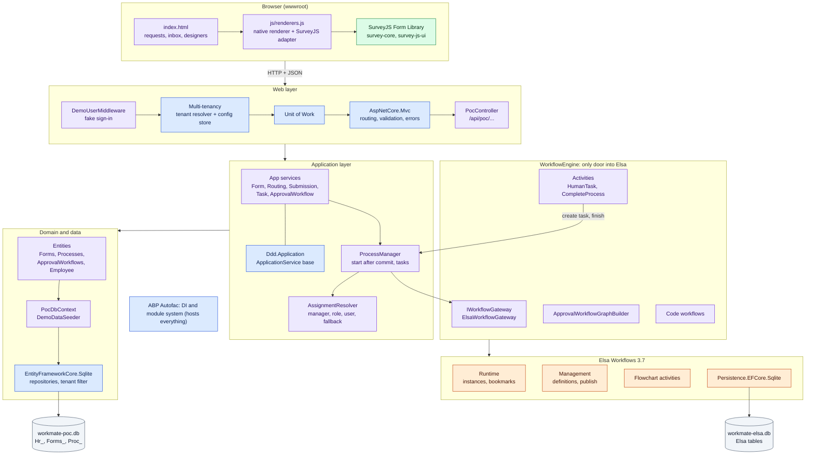
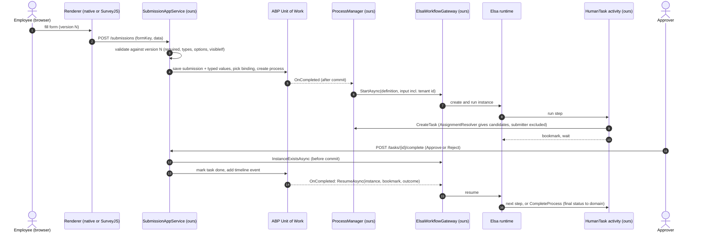
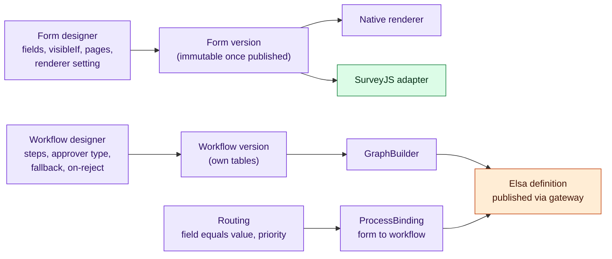

# Workmate HRM PoC: Architecture

The diagrams render on GitHub, GitLab, Azure DevOps and in VS Code (Markdown preview with Mermaid support).
Colours show where each part comes from:

| Colour | Source | Licence |
| --- | --- | --- |
| Blue | **ABP Framework 9.1** (open-source packages only) | LGPL-3.0 |
| Orange | **Elsa Workflows 3.7** | MIT |
| Green | **SurveyJS Form Library 3.2** (renderer only) | MIT |
| Purple | **Our code** (Workmate.Poc) | ours |
| Grey | .NET 10 / ASP.NET Core / EF Core / SQLite | MIT / public domain |

## 1. Components and where they come from

## 2. Runtime flow: submit and approve

## 3. Admin design flow (no code)

## 4. Multi-tenancy

- Tenant comes from the `__tenant` header (ABP `UseMultiTenancy`) and is checked against the signed-in demo user.
- Every domain entity implements ABP `IMultiTenant`; ABP's data filter scopes every query to the current tenant.
- The tenant id travels in workflow input and is re-applied inside Elsa activities (Elsa's own multi-tenancy is not used).
- Designed workflows, routes, forms and renderer settings are tenant data in our tables; Elsa only holds generated definitions and running instances.

## 5. What production changes

| PoC | Production |
| --- | --- |
| `DemoUserMiddleware` fake sign-in | ABP Identity + OpenIddict + Account (spec 003) |
| Config tenant store | ABP TenantManagement (spec 003) |
| SQLite files | SQL Server; Elsa in its own schema on the same server |
| Start/resume via `OnCompleted` | ABP distributed event bus + outbox (Phase F) |
| Single project | ABP modular monolith: Forms, Processes, WorkflowEngine, HR modules |
